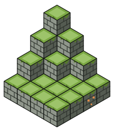

<div align="center">



# Kobblestone

**Run Minecraft the Kubernetes way.**

[](LICENSE)
[](https://kobblestone.io/docs/reference)
[](#getting-started)

[Website](https://kobblestone.io) · [Docs](https://kobblestone.io/docs) · [API reference](https://kobblestone.io/docs/reference) · [Changelog](CHANGELOG)

</div>

Kobblestone is an open-source operator that turns Minecraft servers, proxies, routing, backups and bots into custom
resources. Describe your world in YAML, `kubectl apply` it, and start playing.

```sh
helm install kobblestone oci://ghcr.io/kobblestoneio/charts/kobblestone \
  --namespace kobblestone-system --create-namespace
```

> [!WARNING]
> **Alpha and highly experimental.** All resources are in the `v1alpha1` API version. Some features and concepts are not
> fully implemented yet, and fields and behavior can change between releases, sometimes with manual migration steps.
> Don't rely on Kobblestone for production worlds yet.

- [A server is just another resource](#a-server-is-just-another-resource)
- [Everything a Minecraft network needs](#everything-a-minecraft-network-needs)
- [Made for how clusters actually run](#made-for-how-clusters-actually-run)
- [Getting Started](#getting-started)
- [Special Thanks](#special-thanks)

## A server is just another resource

Kobblestone teaches the Kubernetes API about Minecraft. A `Server` says what to run: the server type, game version,
storage and resources. The operator builds and looks after everything underneath it.

```yaml
apiVersion: kobblestone.io/v1alpha1
kind: Server
metadata:
    name: my-server
spec:
    eula: true
    type: Paper
    version: "26.2"
    storage:
        size: 1Gi
    resources:
        limits:
            memory: 2Gi
```

## Everything a Minecraft network needs

Custom resources that snap together like blocks. Start with a single server and add proxies, routing, backups and bots
when you need them.

|              | Resource       | What it does                                                         |
| ------------ | -------------- | -------------------------------------------------------------------- |
| **Run**      | `Server`       | A Minecraft server. Vanilla, Paper, Purpur, Fabric, Forge and more.  |
|              | `Network`      | A Velocity proxy and the servers behind it, kept compatible with it. |
| **Route**    | `Router`       | Sends players to the right server by hostname, behind one endpoint.  |
|              | `Route`        | A hostname and the server or network it leads to.                    |
| **Protect**  | `BackupRepo`   | Where backups are kept: an S3 bucket or a volume claim.              |
|              | `Backup`       | A snapshot of a server, taken live over RCON or while it is stopped. |
|              | `Restore`      | Puts a backup back onto a server.                                    |
| **Operate**  | `Command`      | Runs an RCON command and keeps the server's response.                |
|              | `CommandGroup` | Runs several commands, one after another.                            |
| **Automate** | `Account`      | A Microsoft account, signed in once via device code.                 |
|              | `Bot`          | A Minecraft-Console-Client bot connected to a server or network.     |

Every field is documented in the [API reference](https://kobblestone.io/docs/reference) and with
`kubectl explain`.

## Made for how clusters actually run

- **Gateway API native.** Attach servers, networks and routers to your existing Gateways and Kobblestone manages the
  `TCPRoute`s. Plain `LoadBalancer` Services work too.
- **Sleeps when nobody plays.** Empty servers pause ticking, or hibernate completely and start again as soon as a player
  connects through a `Router`. Your nodes stay free for everything else.
- **Backups without downtime.** Live backups coordinate with the running server over RCON. Backups and restores of the
  same server queue up and run one at a time.
- **Bots you can script.** Bots run [Minecraft-Console-Client](https://github.com/MCCTeam/Minecraft-Console-Client) and
  are programmed with its own configuration, command scripts and C# scripts, straight from `ConfigMap`s.
- **Sessions any workload can use.** Signed-in accounts produce a session `Secret` in a documented format, so your own
  tools can mount it. The refresh token stays in a separate `Secret`.
- **Every server flavor.** Vanilla, Paper, Purpur, Folia, Fabric, Quilt, Forge and more, on the game version you choose,
  each with its own storage and resource limits.

## Getting Started

### Installing Kobblestone

All you need is a Kubernetes cluster, `kubectl` and [Helm](https://helm.sh/docs/intro/install/). The Helm chart installs
the operator and its custom resources:

```sh
helm repo add kobblestone https://kobblestoneio.github.io/charts
helm repo update
helm install kobblestone kobblestone/kobblestone \
  --namespace kobblestone-system --create-namespace
```

The chart is also published as an OCI artifact, so you can install it without adding the repository:

```sh
helm install kobblestone oci://ghcr.io/kobblestoneio/charts/kobblestone \
  --namespace kobblestone-system --create-namespace
```

See the [installation docs](https://kobblestone.io/docs/installation) for the chart's values, upgrades and uninstalling.

<details>
<summary>Without Helm</summary>

Each release also comes with a plain manifest that contains everything in one file:

```sh
kubectl apply -f https://get.kobblestone.io/v0.3.0/kobblestone.yaml
```

It installs the same components into the namespace `kobblestone-system`. To upgrade, apply the manifest of the new
release; to uninstall, `kubectl delete -f` the manifest you installed.

</details>

### Deploying a simple Vanilla server

Define your server in a `server.yaml` file...

```yaml
apiVersion: kobblestone.io/v1alpha1
kind: Server
metadata:
    name: my-server
spec:
    eula: true
    type: Vanilla
    version: "26.2"
    storage:
        size: 1Gi
    resources:
        limits:
            memory: 2Gi
    jvm:
        memory:
            # You may want to decrease this for lower memory limits
            heapPercentage: 75
```

... and apply.

```batch
kubectl apply -f server.yaml \
    && kubectl wait --for=condition=Running=True server/my-server --timeout=5m
```

The command will wait for the server to be up and running. This may take some time if launched for the first time.

### Exposing your server outside the cluster

By default, servers are only available inside the cluster. You have multiple options for exposing your server, which are
more or less applicable depending on your specific environment.

**Option A: LoadBalancer Service** (not recommended)

The simplest and most straight forward option is to make the servers `Service` of type `LoadBalancer`. If supported by
your environment, it will give your server an external IP where it is reachable.

**Warning**: Beware that if you are in the cloud, this will probably allocate resources that cost money. It is also
recommended to disable RCON if the external IP is routable directly from the internet. Even though RCON is
password-protected, it is still unencrypted.

```yaml
apiVersion: kobblestone.io/v1alpha1
kind: Server
metadata:
    name: my-server
spec:
    # ...
    service:
        type: LoadBalancer
        annotations: {} # Configure environment specifics of LB here (like MetalLB ip-pool)
    rcon:
        disabled: true
```

**Option B: Gateway API**

If you have [Gateway API](https://kubernetes.io/docs/concepts/services-networking/gateway/) >= v1.6.0 installed on your
cluster, this might be the most optimal option for you.

You can easily attach servers (and other resources) to your gateways. Kobblestone will manage the `TCPRoute` for you.

```yaml
apiVersion: kobblestone.io/v1alpha1
kind: Server
metadata:
    name: my-server
spec:
    # ...
    tcpRoute:
        parentRefs:
            - name: my-gateway
              sectionName: minecraft # TCP listener on your gateway
```

Your server will then be accessible through the gateways TCP listener.

**Option C: Router**

You can also expose your server indirectly through a central `Router` instance. The advantage here is that we only have
to expose one component (the router) and all the servers stay cluster internal. In addition to that, we also have
hostname based routing.

For that, we need to deploy and expose a `Router` first.

```yaml
apiVersion: kobblestone.io/v1alpha1
kind: Router
metadata:
    name: my-router
spec:
    replicas: 1 # You can scale routers horizontally
    # You can use a LoadBalancer Service...
    service:
        type: LoadBalancer
    # ... or the Gateway API
    tcpRoute:
        parentRefs:
            - name: my-gateway
              sectionName: minecraft # TCP listener on your gateway
```

Secondly, we can configure the default route on the server.

```yaml
apiVersion: kobblestone.io/v1alpha1
kind: Server
metadata:
    name: my-server
spec:
    # ...
    route:
        parentRef:
            name: my-router
        hostname: server.example.com # Some hostname that resolves to the routers external endpoint
```

## Special Thanks

Kobblestone is built on the shoulders of
[docker-minecraft-server](https://github.com/itzg/docker-minecraft-server), [mc-router](https://github.com/itzg/mc-router),
[docker-mc-backup](https://github.com/itzg/docker-mc-backup), [docker-mc-proxy](https://github.com/itzg/docker-mc-proxy),
[Velocity](https://papermc.io/software/velocity/) and
[Minecraft-Console-Client](https://github.com/MCCTeam/Minecraft-Console-Client). Thank you to
[itzg](https://github.com/itzg) and every other maintainer. Check them out!
